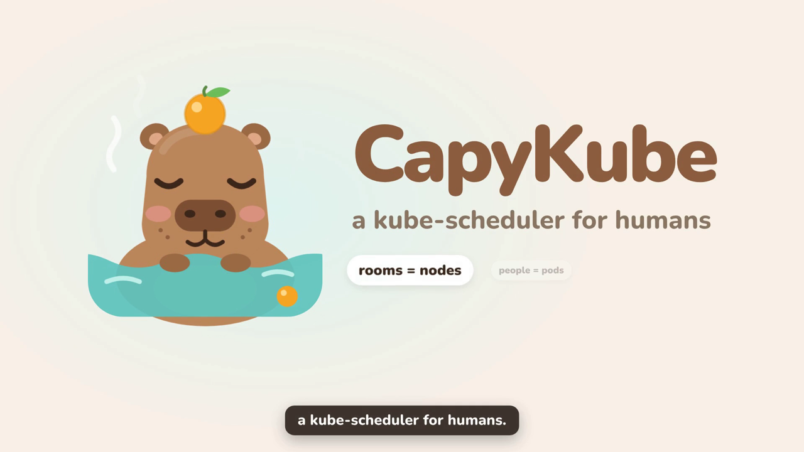
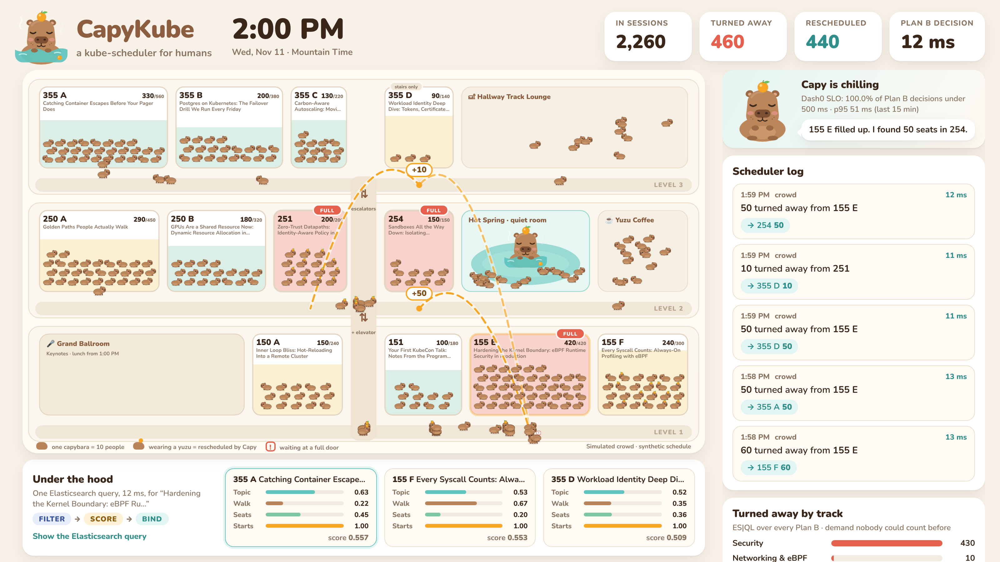
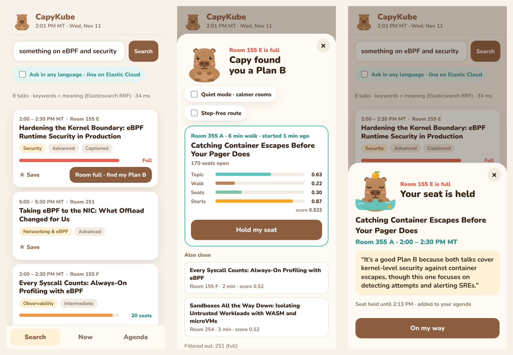
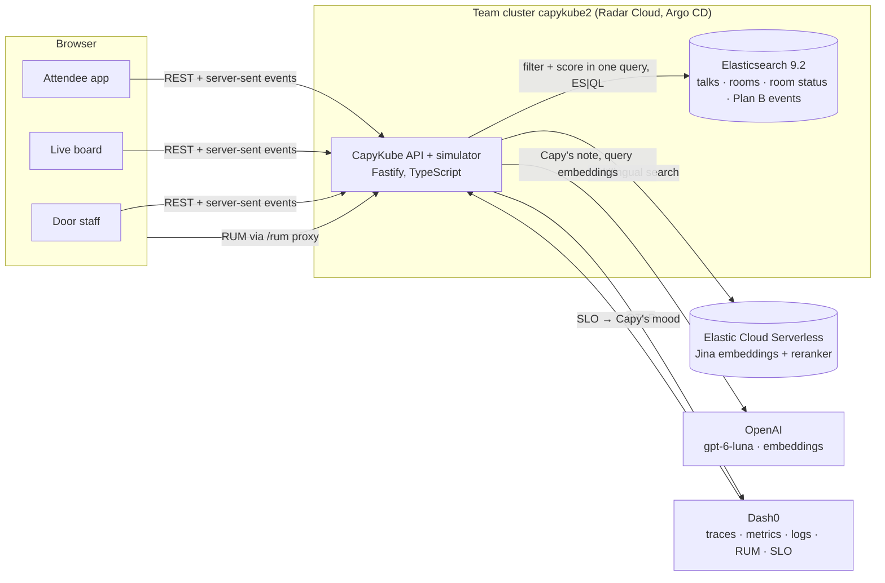
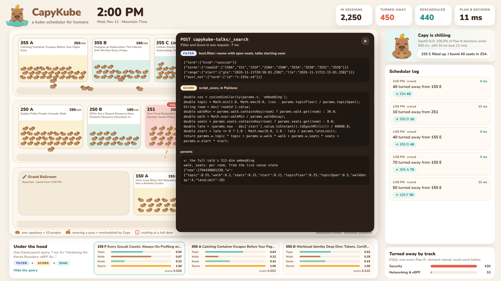
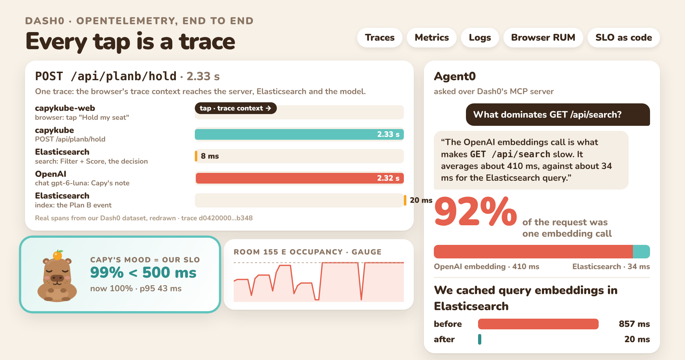
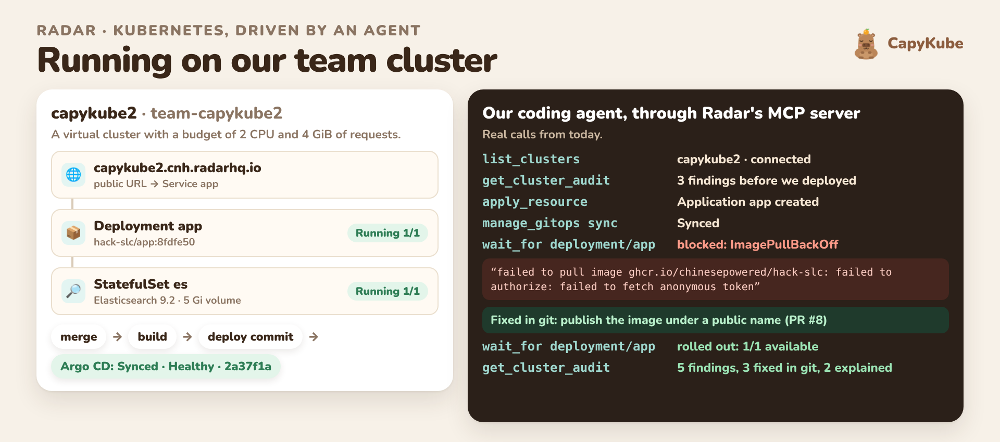
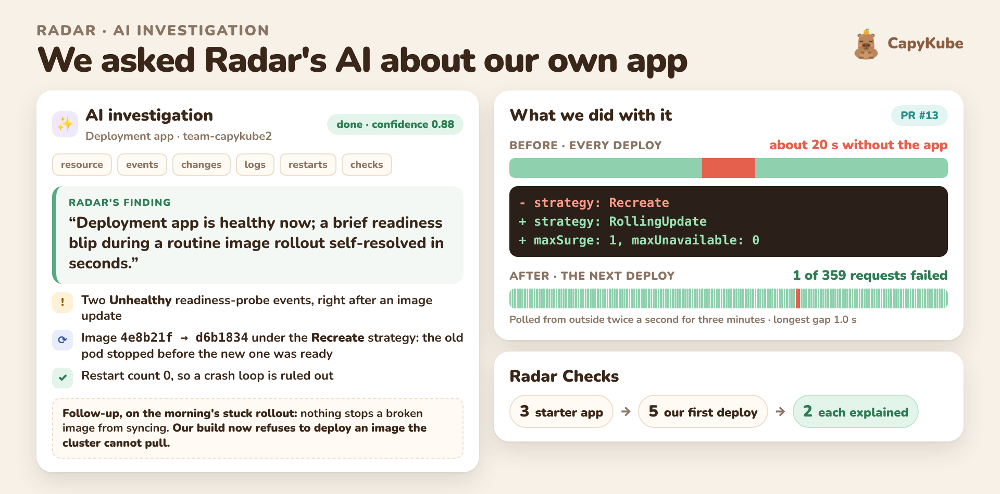
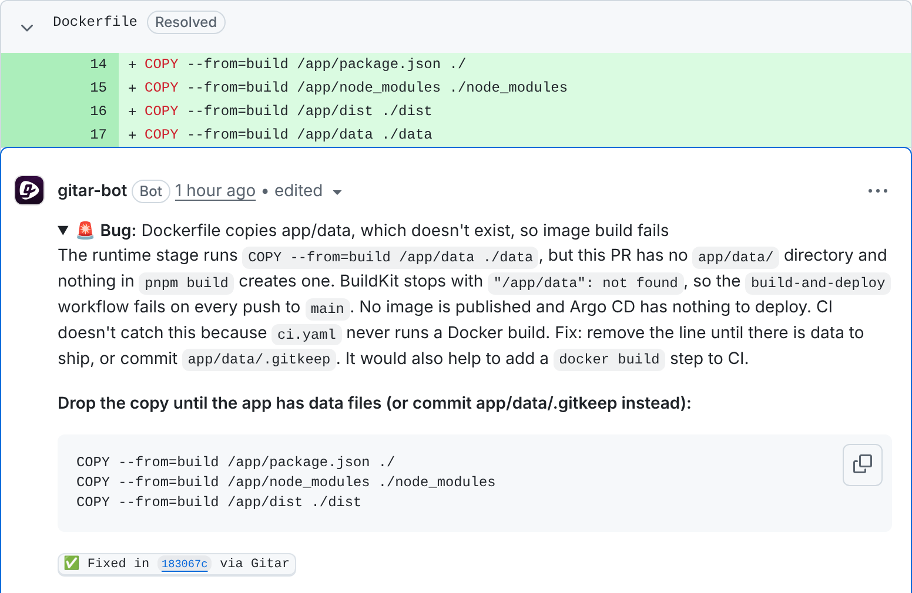
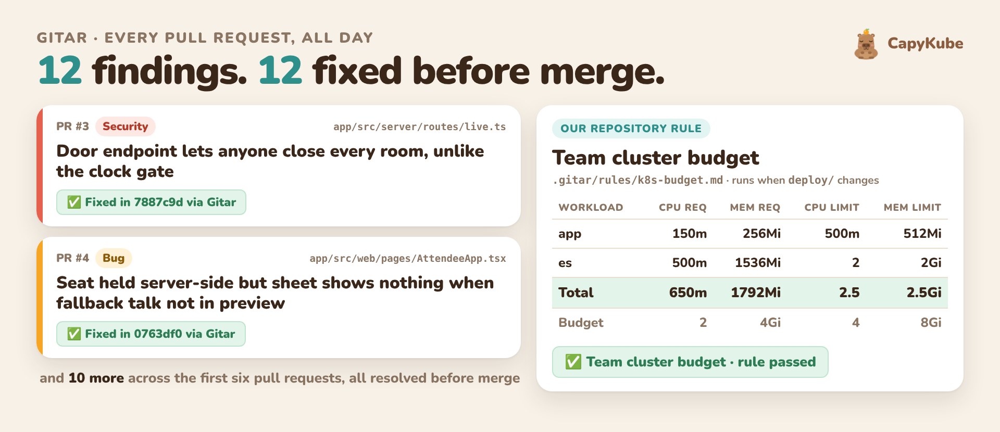

<p align="center">
  
</p>

<h1 align="center">CapyKube</h1>

<p align="center">
  <b>A kube-scheduler for humans.</b><br />
  When the talk you came for is full, Capy finds you the closest talk that still has seats, and holds you one.
</p>

<p align="center">
  <a href="https://www.youtube.com/watch?v=sQ_MszaO0Q4"><b>▶ Watch the demo (3:01)</b></a>
  &nbsp;·&nbsp;
  <a href="https://capykube2.cnh.radarhq.io/live"><b>Live board</b></a>
  &nbsp;·&nbsp;
  <a href="https://capykube2.cnh.radarhq.io"><b>Attendee app</b></a>
</p>

## What CapyKube is

**CapyKube is a web app that gives conference attendees a Plan B the moment
a room fills up.** Popular talks fill early and turn people away, while
similar talks down the hall have empty seats. CapyKube knows how full every
room is. When one fills, it finds each person the closest talk by topic that
still has seats, starts in the next few minutes and is a short walk away,
and holds them a seat while they walk over.

It works like the Kubernetes scheduler, with **rooms as nodes and attendees
as pods**:

| Phase | What Capy does |
| --- | --- |
| **Filter** | Keeps the talks starting in the next few minutes, in rooms with open seats (step-free only, if you ask). |
| **Score** | Ranks them: closest in topic, shortest walk, most free seats, starts soonest. |
| **Bind** | Holds your seat, so Capy never sends 200 people to a room with 30 seats. |

Filter and Score run as **one Elasticsearch query**, in about 10 ms.

There are three things to look at:

- **The attendee app**, on a phone. Search the schedule in your own words,
  or in any language. When your talk is full, one tap shows Capy's pick and
  why, and one more holds your seat.
- **The live board**, on a big screen. The venue as a cluster: 300 simulated
  capybaras, ten people each, walk to their talks. A full room turns red and
  Capy reschedules the overflow. Organizers see something they never had:
  how many people were turned away, by track.
- **The door.** Staff close a room with one tap, and the "Room full" sign
  carries a QR code that opens that room's Plan B. Nothing to install.

All of its data lives in **Elasticsearch**. It sends traces, metrics, logs
and browser RUM to **Dash0** with OpenTelemetry, and Capy's mood on the
board is our SLO. It runs on our team's Kubernetes cluster through Argo CD
and **Radar**. Every change landed through a pull request reviewed by
**Gitar**.

<p align="center">
  <a href="https://www.youtube.com/watch?v=sQ_MszaO0Q4"></a>
</p>

Built at the [Cloud Native Hackathon](https://www.wemakedevs.org/hackathons/cnh),
Salt Lake City, November 9, 2026, by team **capykube2**, for the
Elasticsearch, Dash0, Radar and Gitar tracks.



## Try it in a minute

1. **Open the [live board](https://capykube2.cnh.radarhq.io/live).** It
   replays the rush into the 2:00 PM talks about every 80 seconds: Room
   155 E fills up, turns red, and Capy reschedules 500 people. Click **Show
   the Elasticsearch query** under the map to see the scheduler's one query.
2. **Open the [attendee app](https://capykube2.cnh.radarhq.io) on your
   phone** and tap "something on eBPF and security". When the first result
   says *Full* (from 1:55 PM on the demo clock), tap **Room full · find my
   Plan B**, then **Hold my seat**.
3. **Tick "Ask in any language"** and search in Japanese or Spanish, for
   example `コンテナのセキュリティ`.
4. **Look at the [sign](https://capykube2.cnh.radarhq.io/sign/155E)** that
   goes on a full room's door. Its QR code opens that room's Plan B, so there
   is nothing to install.



The crowd is **simulated** (300 capybaras, ten people each) and the schedule
is a **fictional KubeCon day**: every speaker and company is made up. At a
real event the room counts would come from door staff, badge scans or door
counters.

## Where each sponsor's technology is

| Track | What we did with it | Where to look | In the video |
| --- | --- | --- | --- |
| **Elasticsearch** | The data layer for everything. Hybrid search (BM25 and kNN, fused by RRF). The scheduler as one `script_score` query. ES\|QL for organizer insights. Multilingual search on Elastic Cloud Serverless with Jina embeddings and a reranker. | [search.ts](app/src/server/search.ts), [scheduler.ts](app/src/server/scheduler.ts), [insights.ts](app/src/server/insights.ts), [es-cloud.ts](app/src/server/es-cloud.ts) | [0:30](https://www.youtube.com/watch?v=sQ_MszaO0Q4&t=30s) |
| **Dash0** | OpenTelemetry traces, metrics, logs and browser RUM from the first commit. Dashboard and SLO as code. Capy's mood *is* the SLO. Agent0 found our slowest call, and the fix took search from up to 857 ms to about 20 ms. | [telemetry.ts](app/src/server/telemetry.ts), [observability/dash0/](observability/dash0), [docs/dash0.md](docs/dash0.md) | [1:26](https://www.youtube.com/watch?v=sQ_MszaO0Q4&t=86s) |
| **Radar** | Runs on our team cluster through Argo CD. Our coding agent did every cluster operation through Radar's MCP server. Radar showed why the first rollout was stuck, its Checks went from five findings to two, and its AI investigation led us to close a 20-second gap in every deploy. | [docs/radar.md](docs/radar.md), [STORY.md](STORY.md), [deploy/](deploy) | [1:46](https://www.youtube.com/watch?v=sQ_MszaO0Q4&t=106s) |
| **Gitar** | Every change landed through a pull request that Gitar reviewed against our own instructions and rules, with auto-apply on. It raised 12 findings on the first six pull requests, and all 12 were fixed before merge. | [.gitar/](.gitar), [merged pull requests](https://github.com/chinesepowered/hack-slc/pulls?q=is%3Apr+is%3Amerged) | [2:17](https://www.youtube.com/watch?v=sQ_MszaO0Q4&t=137s) |

## Who uses it

| Who | Where | What |
| --- | --- | --- |
| Attendees | `/` | Search talks by meaning, or in any language. Save an agenda. When a room is full: **find my Plan B**, see why Capy picked it, and hold a seat. |
| Anyone at a full door | the QR code on the sign | `/full/<room>` opens that room's Plan B, right when you need it. |
| Door staff | `/door/<room>` | One tap closes a room, even while seats show free. Everyone heading there is rerouted. |
| Organizers | `/live` | The venue as a cluster: rooms filling, the scheduler log, and **people turned away by track**, which nobody could count before. |
| Printers | `/sign/<room>` | The "This room is full" sign with its QR code. |

### Built for everyone in the hallway

- **Quiet mode** weighs free seats more heavily, so Plan B prefers calmer
  rooms. The Hot Spring quiet room is always open.
- **Step-free routes** leave out rooms you can only reach by stairs.
- **Any language**: ask in your own language and get the right talk.
- **Nothing to install**: a QR code on the door is the way in.
- **Readable by everyone**: our rules require an accessible name on every
  control, text as well as color (a full room says "Full"), visible focus,
  and no motion under `prefers-reduced-motion`. They live in
  [docs/conventions.md](docs/conventions.md), and Gitar reviews every pull
  request against them.

## How it's built



### Elasticsearch: the data layer

- **Talks, rooms, live room status and every Plan B request** live in
  Elasticsearch. The app creates its indices with strict mappings on start
  (`app/src/server/es.ts`).
- **Hybrid search**: BM25 over title, tags and abstract, fused with kNN over
  512-dimension embeddings by the **`rrf` retriever** (`search.ts`).
  "something on eBPF and security" finds talks that say neither word in the
  title.
- **The scheduler is one query** (`scheduler.ts`): a `script_score` whose
  filter is the Filter phase and whose Painless script computes topic
  similarity (`cosineSimilarity` over the talk embeddings), walking time,
  free seats and start time.
- **ES|QL** turns Plan B events into organizer insights: people turned away
  by track and by talk (`insights.ts`).
- **Elastic Cloud Serverless** adds multilingual search: a `semantic_text`
  field embeds every talk with **jina-embeddings-v5** at ingest, and
  **jina-reranker-v3.5** reorders the fused results (`es-cloud.ts`).
- In the cluster, Elasticsearch is a single-node StatefulSet sized for the
  team's budget (`deploy/elasticsearch.yaml`).

The live board shows the scheduler's request as it runs:



### Dash0: OpenTelemetry from the first commit

- **Traces** for every request: Fastify, outgoing HTTP, the Elasticsearch
  client's own spans, and **OpenAI calls with the GenAI semantic
  conventions** (`telemetry.ts`).
- **Metrics that are the product**: room occupancy, people walking or
  waiting, **people turned away by track**, Plan B latency (`metrics.ts`,
  `gauges.ts`).
- **Logs** through pino, correlated with traces.
- **Browser RUM** with the Dash0 web SDK, sent through a `/rum` proxy so no
  token ships to the browser. A tap on the phone and the Elasticsearch query
  it causes share one trace.
- **Dashboard and SLO as code** (`observability/dash0/`): "99% of Plan B
  decisions under 500 ms".
- **Capy's mood is the SLO.** The app reads it from Dash0's PromQL API: Capy
  soaks in the hot spring while it is green and sweats when the error budget
  burns (`dash0-slo.ts`).
- **Agent0 found the slow call.** Asked over Dash0's MCP server, it showed
  that one OpenAI embedding call was 92% of search latency. We cached query
  embeddings in Elasticsearch. The whole story is in
  [docs/dash0.md](docs/dash0.md).



*Drawn from our own Dash0 data for the demo video: the spans, the SLO value and the occupancy series are real.*

### Radar: running it on Kubernetes

- Deployed to the team's cluster from Radar's starter. Every merge builds an
  image and **Argo CD syncs it**.
- Our coding agent drove the cluster through **Radar's MCP server**: it
  created the Secret and the Argo CD Application, synced each deploy, waited
  for each rollout and read the Checks. Nobody ran `kubectl`.
- **Radar found why the first rollout was stuck.** `wait_for` came back
  `blocked` with the pod's `ImagePullBackOff` and the registry's refusal:
  the image had been published while the repository was private. Fixed in
  git ([#8](https://github.com/chinesepowered/hack-slc/pull/8)).
- **Checks before and after**: five medium findings on our workloads after
  the first deploy, three fixed in
  [#9](https://github.com/chinesepowered/hack-slc/pull/9), two left with
  their reasons.
- **An AI investigation we acted on.** Radar's AI investigation found the
  app healthy and traced two readiness warnings to our own rollouts: about
  20 seconds without the app on every deploy. Asked about the morning's
  stuck rollout, it pointed out that nothing stood between a bad image and
  the cluster. [#13](https://github.com/chinesepowered/hack-slc/pull/13)
  fixed both: the next deploy failed one request out of 359, and the build
  now refuses to deploy an image the cluster can't pull. The whole story is
  in [docs/radar.md](docs/radar.md) and [STORY.md](STORY.md).



*Drawn from live cluster state for the demo video: the workloads, the Argo CD revision and the error text are what Radar returned.*



*Drawn for the demo video from the investigation's own output and our availability log.*

### Gitar: every change through a reviewed pull request

- Every change landed as a pull request that Gitar reviewed: see the
  [merged pull requests](https://github.com/chinesepowered/hack-slc/pulls?q=is%3Apr+is%3Amerged).
- **Project-aware review**: `.gitar/review/capykube.md` builds on
  [docs/conventions.md](docs/conventions.md): seat accounting, venue time
  zones, Elasticsearch safety, telemetry, accessibility, cluster budget and
  secrets.
- **Repository rules**: `.gitar/rules/api-contract.md` checks that the web
  client still matches the server whenever the API changes, and
  `.gitar/rules/k8s-budget.md` totals requests and limits against the team's
  budget whenever `deploy/` changes.
- **Auto-apply** with criteria in `.gitar/config/apply.md`. Gitar's 12
  findings include a Dockerfile that would have broken every deploy
  ([#1](https://github.com/chinesepowered/hack-slc/pull/1)), an unbounded
  search size ([#2](https://github.com/chinesepowered/hack-slc/pull/2)), a
  door-control endpoint anyone could call
  ([#3](https://github.com/chinesepowered/hack-slc/pull/3)) and a seat held
  without the attendee seeing it
  ([#4](https://github.com/chinesepowered/hack-slc/pull/4)).





## Would this get used at a real KubeCon?

The problem is real: attendee write-ups from 2017 to 2024 describe popular
KubeCon rooms filling 15 to 30 minutes early and turning people away, even
after rooms got bigger. Some event apps show room occupancy, and badge
scanning lets staff redirect people by hand. CapyKube adds the part that is
missing: an automatic, topic-matched Plan B that spreads people out instead
of creating the next full room, with no new hardware and no app to install.

- **The signal** is the staff who already close the doors: one tap.
- **The entry point** is a QR code on the "Room full" sign.
- **The payoff for organizers**: every Plan B request counts someone turned
  away, by topic. That is the data for sizing rooms and picking talks next
  year.
- **Next: counts that keep themselves.** Door staff are the signal today
  because that needs no hardware. A badge tap or scan at the door (NFC, or
  the QR code already on the badge) or a door counter would feed the same
  per-room counts with nobody typing, and the scheduler would read them the
  way it reads them now. That part is not built.

The realistic path is open source, a pilot at a Kubernetes Community Day,
then an integration with an event platform.

## Run it locally

Requires Node 22, pnpm and Docker.

```bash
docker run -d --name es -p 9200:9200 -e discovery.type=single-node -e xpack.security.enabled=false -e xpack.ml.enabled=false docker.elastic.co/elasticsearch/elasticsearch:9.2.1
```

```bash
cd app && pnpm install && pnpm build
```

```bash
cd app && ES_URL=http://localhost:9200 pnpm start
```

Open http://localhost:8080 and `/live`. Optional environment:

| Variable | What it turns on |
| --- | --- |
| `OPENAI_API_KEY` | Hybrid search (query embeddings) and Capy's note |
| `DASH0_AUTH_TOKEN` | Traces, metrics, logs and RUM to Dash0; Capy's mood from the Dash0 SLO |
| `ES_CLOUD_URL`, `ES_CLOUD_API_KEY` | Multilingual search on Elastic Cloud Serverless |
| `OPS_KEY` | Requires `x-ops-key` for the demo clock and door controls |
| `SIM_SPEED`, `SIM_AGENTS` | Demo clock speed (default 20×) and crowd size (default 300) |
| `SIM_LOOP_START`, `SIM_LOOP_END` | Replay a window of the day (ISO times). The deployed demo loops over 1:42 to 2:09 PM, the rush into the 2:00 PM talks |

Tests: `pnpm test` (unit), `pnpm test:integration` (needs `ES_URL`).

### In the cluster

`deploy/` is what Argo CD syncs. Secrets come from a `capykube-secrets`
Secret created out of band, never committed: `ELASTIC_PASSWORD`,
`OPENAI_API_KEY`, `DASH0_AUTH_TOKEN`, `ES_CLOUD_API_KEY`, `OPS_KEY`.

## AI disclosure

This project was built with an AI coding assistant (Claude Code), as the
hackathon rules allow and require us to disclose. The team chose the idea,
made the product and architecture decisions, reviewed the pull requests and
operated the app. Gitar, an AI code reviewer, reviewed every pull request.
The demo schedule's talk abstracts were partly drafted with an OpenAI model.
The demo video's narration is an ElevenLabs voice, and its music was
generated with ElevenLabs.

## License

Apache 2.0
