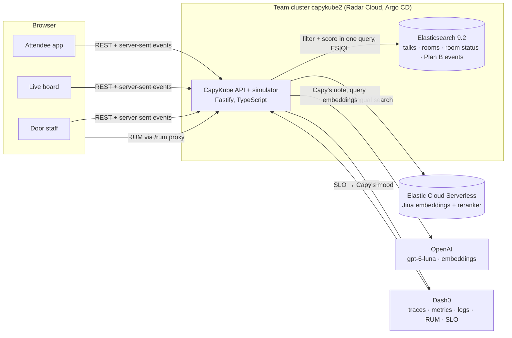

# CapyKube 🦫🍊

**A kube-scheduler for humans.** When the talk you wanted is full, Capy finds
you the closest talk by topic that has seats, starts soon and is a short walk
away, and holds you a seat on the way there.

Popular rooms at KubeCon fill up 15 to 30 minutes early and turn people away,
while similar talks down the hall have empty seats. CapyKube treats the
venue like a cluster: **rooms are nodes with capacity, attendees are pods**.
When a room fills, it reschedules people the way Kubernetes reschedules pods:

1. **Filter**: talks starting within minutes, in rooms with open seats
   (step-free only, if you ask).
2. **Score**: closest in topic (embeddings), shortest walk, emptiest room,
   starts soonest.
3. **Bind**: hold the seat, re-checked synchronously, so Capy never sends 200
   people to a room with 30 seats.

Filter and Score are **one Elasticsearch query**.

Built at the [Cloud Native Hackathon](https://www.wemakedevs.org/hackathons/cnh),
Salt Lake City, November 9, 2026, by team **capykube2**.
Live: **https://capykube2.cnh.radarhq.io** · big screen at
[`/live`](https://capykube2.cnh.radarhq.io/live).

[](docs/media/capykube-demo.mp4)

**[Watch the two-minute demo](docs/media/capykube-demo.mp4)** (narrated, with captions).


## What you can do

| Who | Where | What |
| --- | --- | --- |
| Attendees | `/` | Search talks by meaning ("something on eBPF and security"), or in any language. Save an agenda. When a room is full: **find my Plan B**, with quiet mode and step-free routes, see why Capy picked it, and hold a seat. |
| Anyone at a full door | the QR code on the sign | `/full/<room>` opens that room's Plan B. No app to install, right when you need it. |
| Door staff | `/door/<room>` | One tap closes a room, even while seats show free. Everyone heading there gets rerouted. |
| Organizers | `/live` | The venue as a cluster: rooms filling, hundreds of capybaras walking, Plan B arcs, the scheduler log, and **demand turned away by track**, which nobody could count before. |
| Printers | `/sign/<room>` | The "This room is full" sign with its QR code. |

The live demo **replays the minutes around 2:00 PM on a loop**: every
minute and a half or so, Room 155 E fills up and Capy reschedules the
overflow.

The crowd on the live board is **simulated** (300 capybaras, ten people each)
and the schedule is a **fictional KubeCon day**: every speaker and company is
made up. At a real event the room counts would come from door staff, badge
scans or door counters.

## How it's built



### Elasticsearch: the data layer

- **Talks, rooms, live room status and every Plan B request** live in
  Elasticsearch. The app bootstraps indices with strict mappings and a trial
  license on start (`app/src/server/es.ts`).
- **Hybrid search**: BM25 over title, tags and abstract fused with kNN over
  512-dimension embeddings by the **`rrf` retriever** (`search.ts`).
  "something on eBPF and security" finds talks that say neither word in the
  title.
- **The scheduler is one query** (`scheduler.ts`): a `script_score` whose
  filter is the Filter phase and whose Painless script computes TopicAffinity
  (`cosineSimilarity` over the talk embeddings), WalkTime, SeatsFit and
  StartSoon. The board's "under the hood" panel shows the query and each
  candidate's scores.
- **ES|QL** turns the Plan B events into organizer insights: people turned
  away by track and by talk (`insights.ts`).
- **Elastic Cloud Serverless** adds multilingual search: a `semantic_text`
  field embeds every talk with **jina-embeddings-v5** at ingest, and
  **jina-reranker-v3.5** reorders the fused results through the
  `text_similarity_reranker` retriever (`es-cloud.ts`). Ask in Spanish or
  Japanese and you get the English talk.
- In the cluster, Elasticsearch runs as a single-node StatefulSet sized for
  the team budget, with mmap off because the host refuses the privileged
  sysctl init container (`deploy/elasticsearch.yaml`).

### Dash0: OpenTelemetry from the first commit

- **Traces** for every request: Fastify, outgoing HTTP, the Elasticsearch
  client's native spans, and **OpenAI calls with the GenAI semantic
  conventions** (model, tokens, latency) (`telemetry.ts`).
- **Metrics** that are the product: room occupancy and utilization gauges,
  people walking or waiting, Plan B requests, **people turned away by
  track**, Plan B latency, and Capy's note latency (`metrics.ts`,
  `gauges.ts`).
- **Logs** through pino, correlated with traces.
- **Real-user monitoring** with the Dash0 web SDK, sent through a `/rum`
  proxy so no token ships to the browser. Same-origin calls carry trace
  context, so a tap on the phone and the Elasticsearch query it causes share
  one trace.
- **Dashboard and SLO as code** (`observability/dash0/`, applied with
  `scripts/dash0-apply.sh`): "99% of Plan B decisions under 500 ms".
- **Capy's mood is the SLO.** The app reads the SLO from Dash0's PromQL API:
  Capy chills in the hot spring with a yuzu while it's green and sweats when
  the error budget burns (`dash0-slo.ts`).

### Radar: running it on Kubernetes

- Deployed to the team's vcluster from Radar's starter: every merge builds
  an image and **Argo CD syncs it**. Our coding agent drives the cluster
  through **Radar's MCP server**: it created the Secret and the Argo CD
  Application, syncs each deploy commit, waits for each rollout and reads
  the Checks. Nobody ran `kubectl`.
- **Radar found why the first rollout was stuck.** `wait_for` came back
  `blocked` with the pod's `ImagePullBackOff` and the registry's refusal:
  the image had been published while the repository was private. Fixed in
  git ([#8](https://github.com/chinesepowered/hack-slc/pull/8)).
- **Checks before and after**: five medium findings on our workloads after
  the first deploy, three fixed in
  [#9](https://github.com/chinesepowered/hack-slc/pull/9), two left with
  their reasons. The whole story is in [docs/radar.md](docs/radar.md).

### Gitar: every change through a reviewed PR

- Every change landed as a pull request that Gitar reviewed, from
  [#1](https://github.com/chinesepowered/hack-slc/pull/1) to the last one:
  see the [merged pull requests](https://github.com/chinesepowered/hack-slc/pulls?q=is%3Apr+is%3Amerged).
- **Project-aware review**: `.gitar/review/capykube.md` builds on
  [docs/conventions.md](docs/conventions.md) (seat accounting, venue time
  zones, Elasticsearch safety, telemetry gaps, accessibility, cluster
  budget, secrets).
- **Repository rules**: `.gitar/rules/api-contract.md` checks the web client
  still matches the server whenever the API changes;
  `.gitar/rules/k8s-budget.md` totals requests and limits against the team
  budget whenever `deploy/` changes.
- **Auto-apply** with criteria in `.gitar/config/apply.md`. What Gitar
  caught and fixed on its own includes a Dockerfile that would have broken
  every deploy (#1), an unbounded search size and a NaN page size (#2), a
  door-control endpoint anyone could abuse (#3), and two Plan B UI races
  (#4).

## Would this get used at a real KubeCon?

The problem is real: attendee write-ups from 2017 to 2024 describe popular
KubeCon rooms filling 15 to 30 minutes early and turning people away, even
after rooms got bigger. Some event apps show room occupancy, and badge
scanning lets staff redirect people by hand. CapyKube adds the part that's
missing: an automatic, topic-matched Plan B that spreads people out instead
of creating the next full room, with no new hardware and no app to install:

- **The signal** is the staff who already close the doors: one tap.
- **The entry point** is a QR code on the "Room full" sign.
- **The payoff for organizers**: every Plan B request counts someone turned
  away, by topic. That's the data for sizing rooms and picking talks next year.

The realistic path is open source, a pilot at a Kubernetes Community Day,
then an integration with an event platform.

## Run it locally

Requires Node 22, pnpm and Docker.

```bash
docker run -d --name es -p 9200:9200 -e discovery.type=single-node -e xpack.security.enabled=false -e xpack.ml.enabled=false docker.elastic.co/elasticsearch/elasticsearch:9.2.1
```

```bash
cd app && pnpm install && pnpm build
```

```bash
cd app && ES_URL=http://localhost:9200 pnpm start
```

Open http://localhost:8080 and `/live`. Optional environment:

| Variable | What it turns on |
| --- | --- |
| `OPENAI_API_KEY` | Hybrid search (query embeddings) and Capy's note |
| `DASH0_AUTH_TOKEN` | Traces, metrics, logs and RUM to Dash0; Capy's mood from the Dash0 SLO |
| `ES_CLOUD_URL`, `ES_CLOUD_API_KEY` | Multilingual search on Elastic Cloud Serverless |
| `OPS_KEY` | Requires `x-ops-key` for the demo clock and door controls |
| `SIM_SPEED`, `SIM_AGENTS` | Demo clock speed (default 20×) and crowd size (default 300) |
| `SIM_LOOP_START`, `SIM_LOOP_END` | Replay a window of the day (ISO times). The deployed demo loops over 1:42 to 2:14 PM, the rush into the 2:00 PM talks |

Tests: `pnpm test` (unit), `pnpm test:integration` (needs `ES_URL`).

### In the cluster

`deploy/` is what Argo CD syncs. Secrets come from a `capykube-secrets`
Secret created out of band, never committed: `ELASTIC_PASSWORD`,
`OPENAI_API_KEY`, `DASH0_AUTH_TOKEN`, `ES_CLOUD_API_KEY`, `OPS_KEY`.

## AI disclosure

This project was built with an AI coding assistant (Claude Code), as the
hackathon rules allow and require us to disclose. The team chose the idea,
made the product and architecture decisions, reviewed the pull requests and
operated the app. Gitar, an AI code reviewer, reviewed every pull request.
The demo schedule's talk abstracts were partly drafted with an OpenAI model.

## License

Apache 2.0
